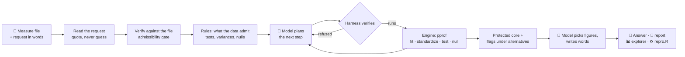

<div align="center">

# pprof Agent

**A local AI agent for provider profiling: describe the quality measure in a sentence, get the flagged providers, the flags under every other defensible choice, the figures and a report, with every number computed by a verified statistical engine.**

[](https://www.r-project.org/)
[](https://www.python.org/)
[-6f42c1)](https://huggingface.co/Qwen/Qwen3-8B-AWQ)
[-27588F)](https://github.com/UM-KevinHe/pprof)


<sub>▶️ Full demo video: <a href="docs/demo.mp4">docs/demo.mp4</a> · screenshots in <a href="docs/shots/">docs/shots/</a></sub>

</div>

---

## Overview

Provider profiling asks which hospitals, dialysis facilities or other providers have outcomes that differ from what their patients would predict. The analysis has three steps that are easy to get wrong: a risk-adjustment model with one effect per provider (thousands of them, many small), a standardized measure per provider, and a test of each provider against the norm whose variance, statistic and reference distribution all have to suit the data at hand. Wald tests fail at providers whose outcomes are all the same; a variance that treats a patient's repeated months as independent is too small; the theoretical null overflags when the statistics are overdispersed.

**pprof Agent** runs this analysis from a plain-language request:

> *"I want to profile the dialysis facilities in this file on monthly hospitalization. The outcome is HOSPITALIZED (1 if the patient was admitted that month), one row per patient-month, and a higher rate is worse. FACILITY identifies the facility and PATIENT the patient. Leave out facilities with fewer than 11 patients. Please adjust for AGE, FEMALE, DIABETES, HEART_FAILURE, COPD, BMI, YEARS_ON_DIALYSIS, NURSING_HOME, ALBUMIN and HEMOGLOBIN."*

It reads the request and the file, settles from the data what only the data can settle, derives by rule which tests the data admit, lets a locally hosted language model plan the analysis one verified step at a time, and reports the flags per provider together with the flags under every other admissible choice, the figures the model picked from a catalogue, a report and a script that reproduces every table without the model.

🔒 **Everything runs where the data live.** The language model is served locally; no row and no number leaves the machine.

---

## What you get

| | |
|---|---|
| 🎯 **Flags per tail** | Which providers are worse than expected, which better, under the test the data call for, with a plain statement of why that test. |
| 🔁 **Flags under the alternatives** | The same flags under every other admissible statistic, variance, standardization and reference distribution, and the providers whose status changes. "Six of the seven flagged facilities hold under all alternatives." |
| 🧠 **The model plans, the evidence decides** | The language model proposes the next analysis step from a closed set of engine operations; a deterministic harness verifies each proposal (admissible? prerequisites met? in budget?), runs it and keeps a protected core that always runs whatever the model proposes. |
| 🔢 **No number is written by the model** | The model writes words around named references; the harness fills every number from the engine's tables. The report, the chat answers and the figures all come from the same tables. |
| 📈 **Figures and an explorer** | Funnel and caterpillar plots, observed against expected, the risk model's coefficients, the empirical null by size group, the stability of every flag; an interactive explorer that re-reads the flags under any configuration. |
| ♻️ **Reproducible** | Each run ships `repro.R`, which recomputes every table from the R engine alone, an audit trail of every model call, and the specification with the source of each field (quoted, inferred from the data, asked, or default). |
| 💬 **Questions after the run** | "Why is facility F00087 flagged worse?" "What would change under the theoretical null?" "Why not use the Wald test?" The agent answers from the breakdowns and comparisons the engine computed. |

---

## A conversation

1. **Upload the measure file** (or pick the example): one row per observation, a provider column, a patient column, the risk factors. The agent profiles it and asks only what the data cannot settle.
2. **Describe the measure** in your own words, as above. Fields the sentence does not state are inferred from the data when they can be, asked by number otherwise.
3. **Watch the analysis run.** The right-hand panel lists each step as it happens: the fit, the standardized measures, the tests, the empirical null, the comparisons, the figures. A planned analysis takes a few minutes with an 8B model on one GPU.
4. **Read the answer**: the reported test and why, the flags, the model's summary with every number filled in, the figures it chose, and the report.
5. **Ask.** Facilities, alternatives, the test, a figure. Every answer is grounded in the engine's tables; the flagged providers are listed by the harness, never by the model.

---

## How it works



* **Declared, not inferred.** The outcome, the unit, the direction, the eligibility threshold and the adjusters come from the analyst's words; the model extracts them by quoting and the harness verifies each against the file. A column the file does not have is refused by name.
* **Derived by rule.** Wald-type statistics are not reported when some providers have invariant outcomes; naive variances are not reported with repeated observations per patient; the stabilized variance replaces the robust one when the median provider is small; the empirical null replaces the theoretical one when the statistics are overdispersed by size group. The rules and their thresholds are printed in the report.
* **Verified before it runs.** Each proposal of the model is checked against a closed action set with typed arguments; refusals go back to the model with the reason; prerequisites the harness can supply, it supplies.
* **Every number from the engine.** The statistical engine is the `pprof` R package (fixed provider effects by a block-ascent Newton algorithm, exact, score and Wald tests with naive, robust and stabilized variances, indirect and direct standardization, the size-stratified empirical null, variable selection with the provider effects unpenalized), reached through a JSON bridge.

---

## Running it

**Replay (no model, no R).** The web app in `site/` replays recorded runs on the synthetic example data:

```bash
cd site && python -m http.server 8000      # then open http://localhost:8000
```

**The agent itself** needs R (≥ 4.5) with the [`pprof`](https://github.com/UM-KevinHe/pprof) package, version 2.0 or later (`remotes::install_github("UM-KevinHe/pprof")`), and Python 3.11 with `pprof_py`, `pandas`, `openai`, `fastapi`, `uvicorn`. The language model is Qwen3-8B (AWQ) served by vLLM with constrained JSON decoding:

```bash
vllm serve Qwen/Qwen3-8B-AWQ --port 8000 --served-model-name qwen3-8b-awq \
    --structured-outputs-config '{"backend": "xgrammar", "disable_any_whitespace": true}' \
    --reasoning-parser qwen3 --default-chat-template-kwargs '{"enable_thinking": false}'

# the web app with the live backend (what the demo video shows)
PPROF_AGENT_ENDPOINT=http://localhost:8000/v1 PPROF_AGENT_MODEL=qwen3-8b-awq uvicorn server:app --port 8765

# the same conversation from the command line, one message per line
python -m pprof_agent.chat --data examples/demo/data.csv --out runs --endpoint http://localhost:8000/v1 \
    --model qwen3-8b-awq --script examples/demo/scenarios/demo.txt

# without a language model: numbered replies and the harness's own plan
python -m pprof_agent.cli run --data examples/demo/data.csv --out runs --spec examples/demo/specification.json --calibrate 30
```

`PPROF_AGENT_MAX_STEPS` bounds the planner (default 24; the demo video uses 8). The test suite runs with `pytest tests` and a deterministic fake model.

---

## Repository layout

| path | what |
|---|---|
| `pprof_agent/` | the Python harness: specification, rules, actions, the planning loop, comparisons, report, the model boundaries and their policies |
| `pprof_agent/policies/`, `knowledge/` | the prompts of each model act (typing, extraction, planning, figures, prose, explanation) and the method notes and display catalogue the model reads |
| `r_scripts/` | the statistical engine behind a JSON bridge: profiling, verification, fitting, standardization, tests, empirical null, breakdowns, calibration by simulation |
| `server.py` | the live backend (FastAPI): sessions, messages answered in the background, bundles for the web app |
| `site/` | the web app (`index.html` + `assets/`); `data/` holds the recorded runs it replays |
| `examples/demo/` | the synthetic demo data set: data, dictionary, a published specification, the planted truth, the scripted scenarios |
| `sim/` | the generator of synthetic measure files with planted truth |
| `train/` | post-training experiments: simulated tasks with known truth, supervised fine-tuning and preference optimization of the planner's choices |
| `tests/` | the test suite |
| `docs/` | the demo video, GIF and screenshots |

---

## The example data

Everything in this repository is synthetic. `examples/demo/data.csv` is one year of patient-month records from 200 dialysis facilities, generated by `sim/make_examples.R` from a model with known facility effects: six facilities truly worse than the norm, four truly better, two whose outcomes are all zero, fifteen with three patients or fewer, one "decoy" whose patients are much sicker but whose true effect is zero, and a patient random effect so that months of the same patient are correlated. `truth.json` records all of it; `dictionary.md` describes the columns. **No patient or facility data from any real source is included.**

---

## Related

* [`pprof`](https://github.com/UM-KevinHe/pprof) (R) and [`pprof_py`](https://github.com/UM-KevinHe/pprof_py) (Python): the statistical software for provider profiling that the agent drives, organized by analysis step (data, risk adjustment, standardized measures, testing, reliability, plots).

## Citation

If you use pprof Agent, please cite the accompanying paper (citation to be added).

## Contact

Questions and issues: please open a [GitHub issue](https://github.com/UM-KevinHe/pprof-agent/issues).
